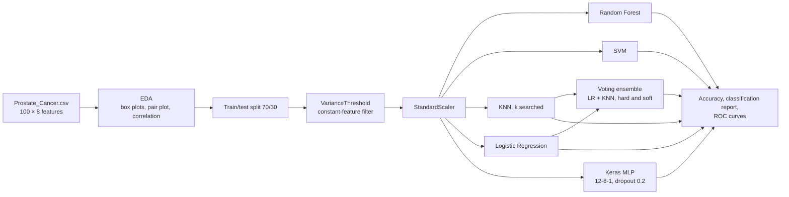
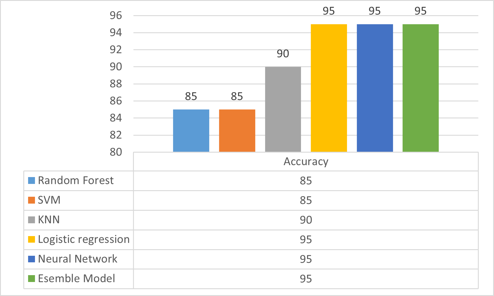

# Prostate Cancer Prediction with Machine Learning

A comparison of classical classifiers, a small neural network and a voting ensemble for predicting whether a prostate tumour is malignant or benign from eight tumour measurements.

This repository contains the notebook and data for the IEEE paper **"Can Machine Learning Techniques Predict Prostate Cancer Accurately? The Fact and Remedy"** ([IEEE Xplore](https://ieeexplore.ieee.org/document/9641099)), on which I am first author.

> This is a research exercise on a small public dataset. It is not a diagnostic tool and must not be used for clinical decisions.

## Data

[`dataset/Prostate_Cancer.csv`](dataset/Prostate_Cancer.csv): **100 patients**, label `diagnosis_result` (`M` malignant / `B` benign) and eight numeric features: `radius`, `texture`, `perimeter`, `area`, `smoothness`, `compactness`, `symmetry`, `fractal_dimension`.

## Method



## Results

Test accuracy saved in the notebook (30 held-out patients, so one patient ≈ 3.3 percentage points):

| Model | Test accuracy |
|---|---:|
| Keras neural network | 90.00% |
| Voting ensemble (LR + KNN) | ≈ 90% (from its classification report) |
| K-Nearest Neighbours | 86.67% |
| Logistic Regression | 86.67% |
| Random Forest | 80.00% |
| SVM | 80.00% |

The paper reports a best result of 95% accuracy, 94% precision and 96% recall. Those figures are **not** reproduced by the outputs saved in this notebook, which top out at 90%; the difference is most likely run-to-run variance on a 30-sample test set.




## Repository structure

```text
Prostate_Cancer_Predictio/
├── prostate_canacer_using_Machine_learning.ipynb   # Full analysis
├── dataset/Prostate_Cancer.csv
├── images/        # EDA plots, accuracy chart, ROC curves, method diagram
└── accuracy.xlsx  # Accuracy summary used for the chart
```

## Running the notebook

```bash
git clone https://github.com/hasansust32/Prostate_Cancer_Predictio.git
cd Prostate_Cancer_Predictio
python -m venv .venv && source .venv/bin/activate
pip install jupyter pandas numpy scikit-learn tensorflow matplotlib seaborn
jupyter notebook prostate_canacer_using_Machine_learning.ipynb
```

The notebook was written in Google Colab. Skip the Google Drive cell and load `dataset/Prostate_Cancer.csv` directly. There is no pinned environment; Keras is used through TensorFlow.

## Limitations

- **Very small dataset.** With 100 patients and a 30-patient test set, accuracy differences of a few points are within noise. Cross-validation would give a more reliable comparison.
- No fixed random seeds, so results change between runs.
- No external validation set and no calibration analysis.

## Future improvements

- Stratified, repeated k-fold cross-validation with confidence intervals.
- Fixed seeds and a pinned `requirements.txt` so results are reproducible.
- Report sensitivity for the malignant class as the primary metric.

## Author

**S M Mahamudul Hasan** · [GitHub](https://github.com/hasansust32) · [Portfolio](https://www.hasansm.com/) · [LinkedIn](https://www.linkedin.com/in/sm-mahamudul-hasan/)
